# 납기 알리미

> 지연은 막을 수 없어도, **지연을 아는 시점과 연구원에게 알리는 시점의 간격**은 줄일 수 있다는 문제 정의에서 출발한 Windows 데스크톱 앱.
> MRO 물류 업무 경험에서 출발한 **포트폴리오·연습용 프로토타입**이고, 데이터는 모두 가상입니다.

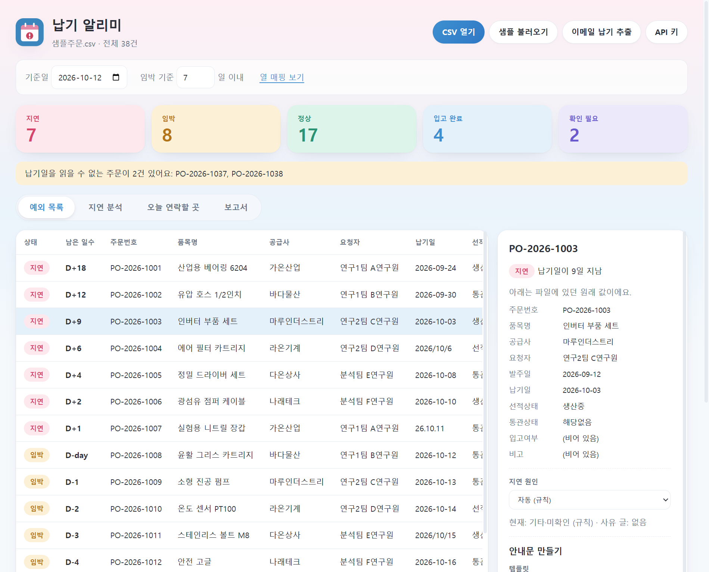

## 문제

| | |
|---|---|
| 배경 | 연구소에서 연구원과 공급사 사이를 잇는 MRO 물류 업무를 했다. 연구원의 불만은 **"늦어서"와 "미리 알려주지 않아서"** 두 가지였다. 지금은 퇴사한 상태라 실제 데이터 없이 경험과 가상 데이터로 만들었다. |
| 핵심 통찰 | 지연 원인(재고 없음·해외 선적·통관·단종·공급사 발주 지연)은 대부분 **내가 통제할 수 없다.** 통제할 수 있는 건 **지연을 아는 시점과 연구원에게 알리는 시점의 간격**이다. |
| 문제 | 납기 정보가 이메일·엑셀·공급사 포털에 흩어져 있어 지연 조짐을 늦게 알아채고, 안내했는지 남는 기록도 없어 선제 안내가 안 된다. 그 결과 연구원 불만과 반복 문의가 생긴다. |
| 처음엔 몰랐던 것 | 지연 원인 비중, 지연 빈도와 평균 지연 일수, 납기 데이터의 실제 형식과 위치. 모두 **(가정)**이며 입사 후 검증할 항목이다. |
| 첫 결과물 | 주문 목록(CSV, 이후 엑셀 .xlsx도) 하나를 읽어 **납기 임박·지연 주문만** 보여 주는 가장 작은 화면. 이후 "연구원 안내 기록"으로 문제의 핵심(알렸는가)을 직접 다루게 확장했다. |

5 Whys, 이슈 트리, 통제 가능성 분석, 가정과 검증 계획은 [문제정의서](문제정의서.md)에 정리했습니다. 처음 문제 정의는 [문제 발굴소](https://claude.ai/artifact/JX58aHgDoCkw4u9vkwNB9m)(직접 만든 도구; 내 계정 로그인이 필요한 비공개 링크)에서 다듬었고, 인터뷰로 요구사항을 정해 [기획문서](기획문서.md)를 먼저 쓴 뒤 만들었습니다.

## 할 수 있는 일

| 하는 일 | 화면 |
|---|---|
| **납기 임박·지연 주문만 골라 보기**: 지연·임박·확인 필요·정상·입고 완료로 판정하고, 급한 순서로 정렬. 납기일을 읽을 수 없는 주문은 숨기지 않고 "확인 필요"로 보여 줌 |  |
| **지연 분석**: 원인별(규칙 + 직접 수정)·공급사별·연구원별 지연, 평균·최장 지연 일수 | 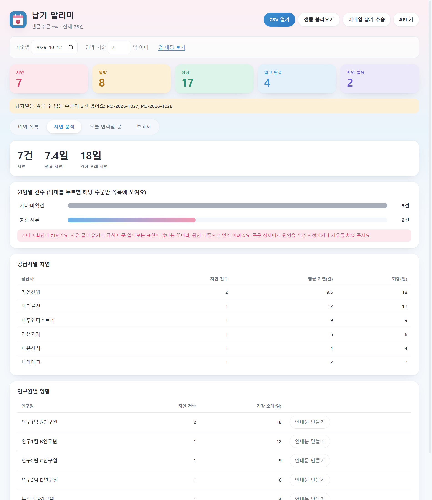 |
| **오늘 연락할 곳**: 지연·임박·확인 필요·미회신 주문을 **공급사별로 묶어 급한 순서대로**. 연락 이력(채널·무응답 횟수·구두 약속)과 다음 조치 제안, 단계별 문구 | 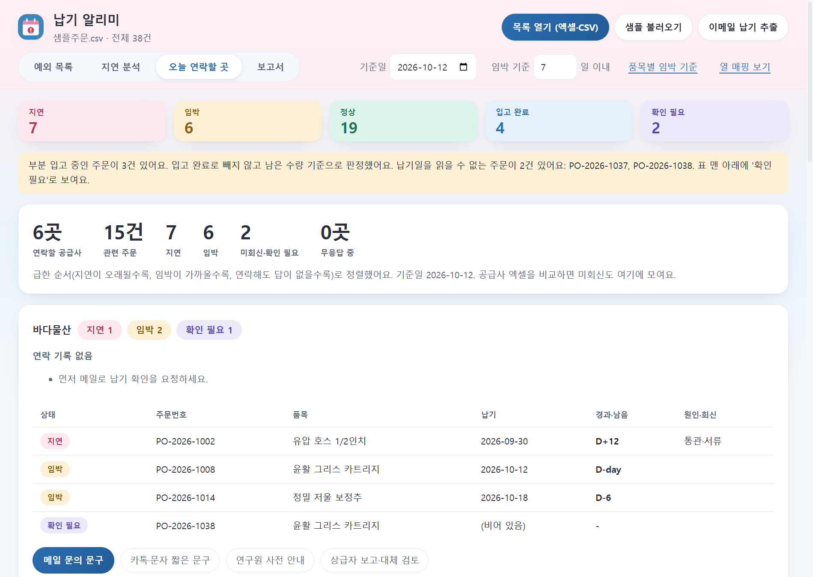 |
| **이메일에서 납기 추출**: 붙여넣기 또는 `.eml` 메일 폴더(기간·납기 메일 필터). 주문마다 **근거 문장**을 보여 주고, 확인한 뒤에만 목록에 반영 | 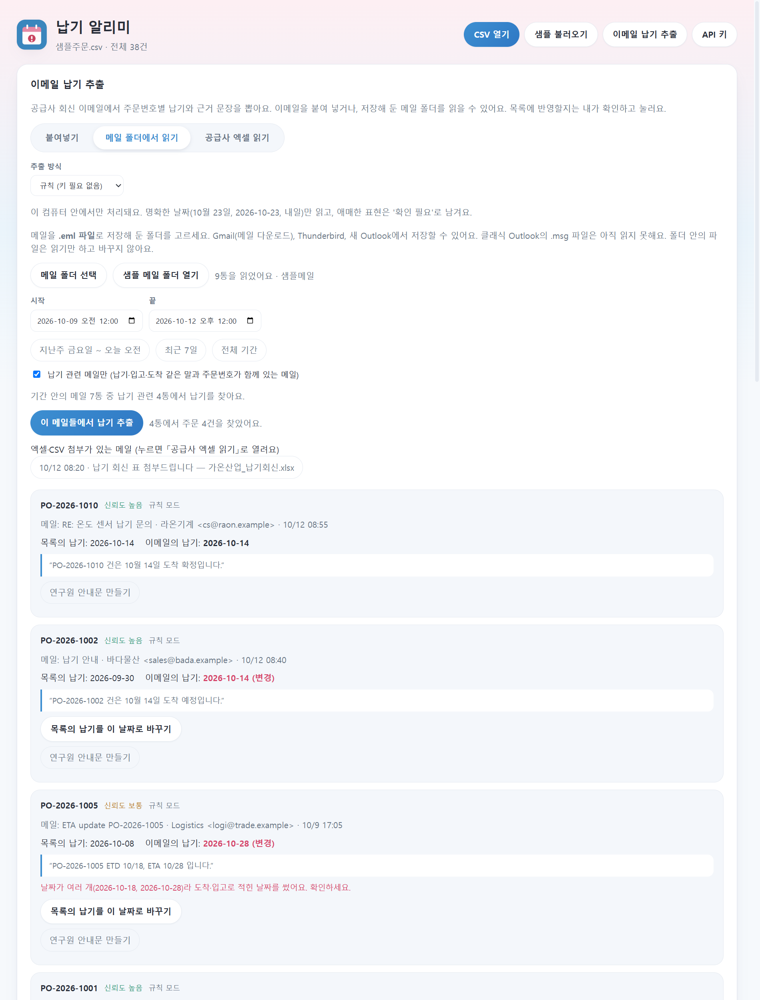 |
| **공급사 엑셀 읽기**: 제목 줄이 밀리고 열 이름이 달라도 머리글 줄·열을 찾음. 빈칸·"확인 후 회신"은 **미회신**으로 모아 재문의 문구 생성 | 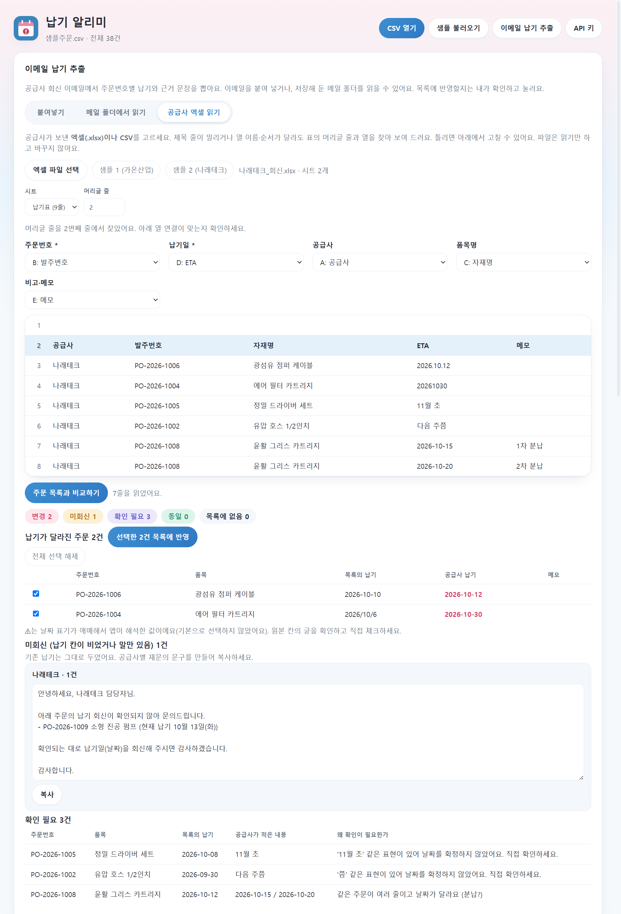 |
| **사람별 보기·한 통 안내문**: 표나 지연 분석에서 연구원·공급사를 누르면 그 사람의 지연·임박 주문만 모아 보고, 연구원에게는 여러 건을 한 통으로 묶은 안내문을 만듦 | 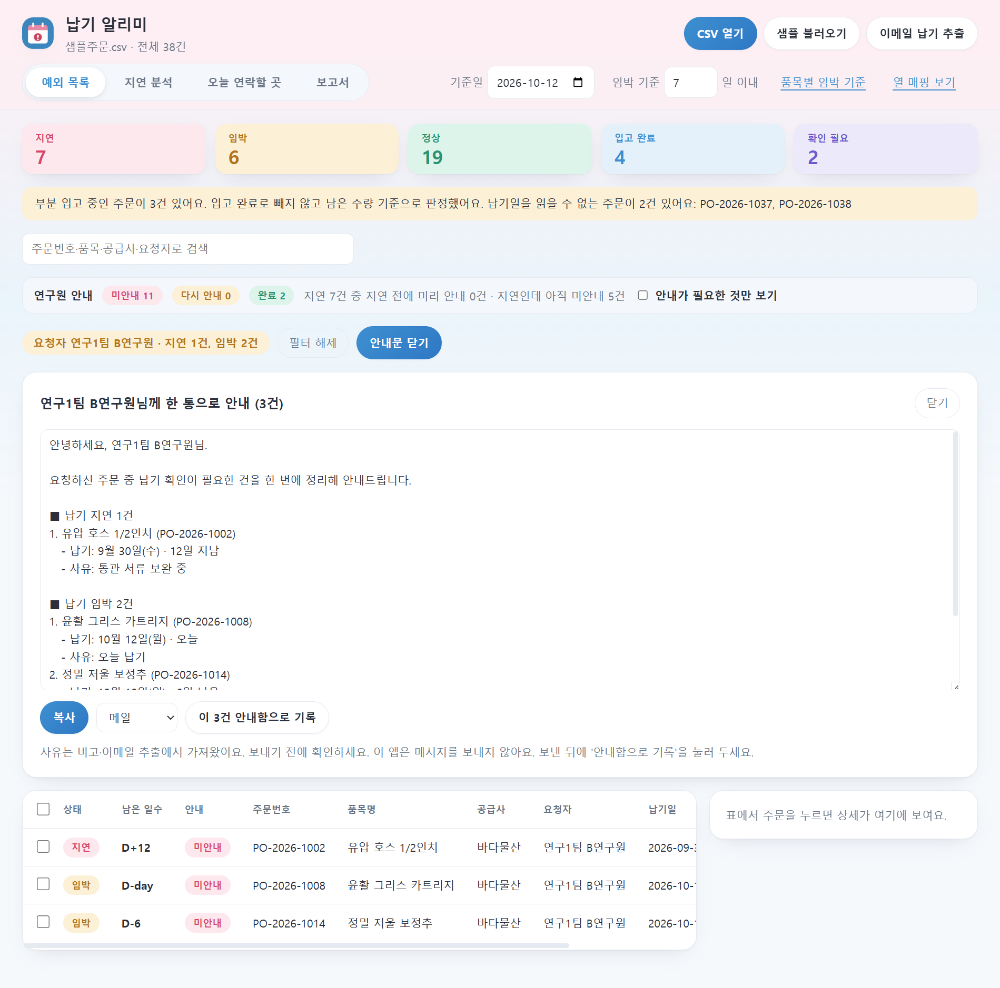 |
| **연구원 안내 기록**: 지연·임박 주문마다 "연구원에게 알렸는가"를 채널·날짜와 함께 남김. 표에 미안내·다시 안내·안내 완료를 표시하고, 안내 뒤 **납기가 바뀌거나 임박→지연이 되거나 지연 중 7일 넘게 소식이 없으면 "다시 안내"**로 알림. 한 통 안내문·선택 건 일괄 기록, "지연 전에 미리 안내한 비율" 집계, 보고서·CSV에 반영 | 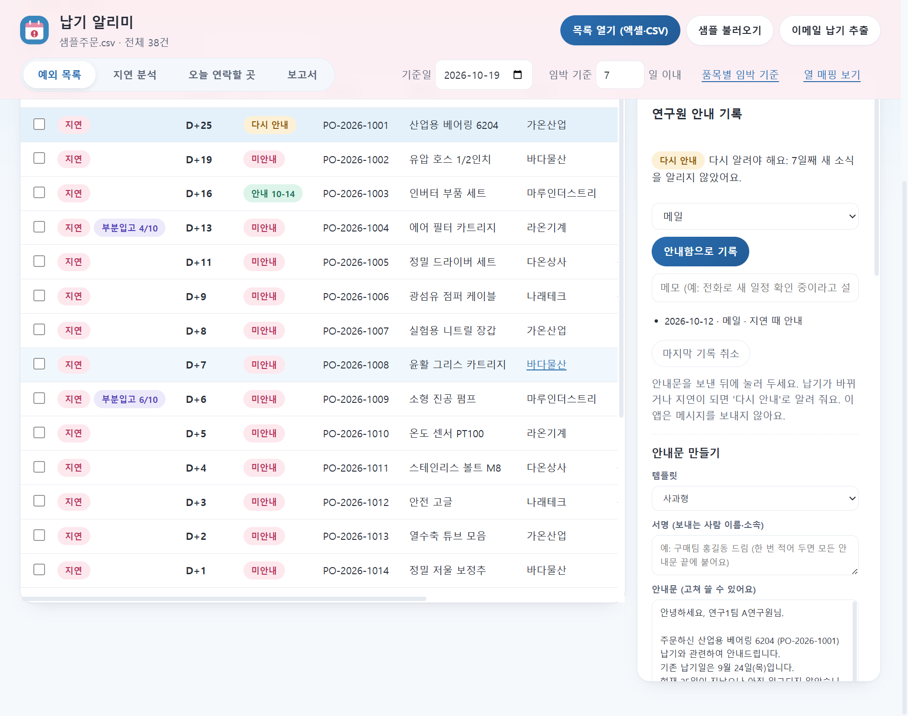 |
| **빠른 메모**: 전화·메신저로 들은 소식을 주문 상세에서 글 하나로 남김(300자, 주문당 50건, Ctrl+Enter, 지울 때 한 번 더 확인). 표 안내 칸에 "메모 N"이 붙고 안내 상태에는 영향이 없음 | 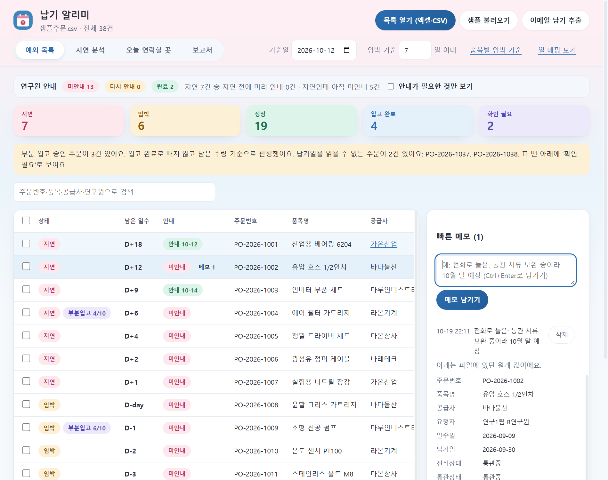 |
| **엑셀(.xlsx) 주문 목록**: CSV로 다시 저장하지 않고 그대로 열기. 표 위 제목 줄은 건너뛰고, 시트가 여럿이면 고르고, 5,000줄·80열을 넘으면 "일부만 읽었다"고 알림. `.xls`·손상·암호 파일은 이유를 안내 | 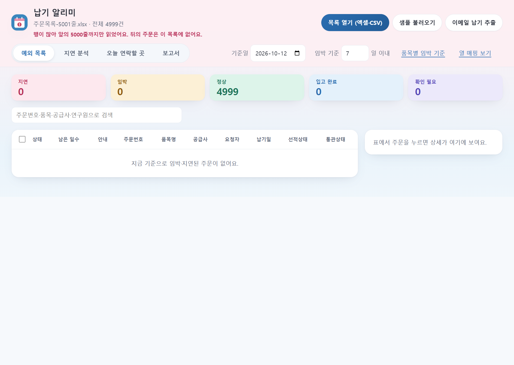 |
| **다시 안내 기준 설정**: 지연 중인 주문을 마지막 안내 뒤 며칠 지나면 "다시 안내"로 볼지 1~30일로 지정(기본 7일), 바꾸면 바로 반영 | 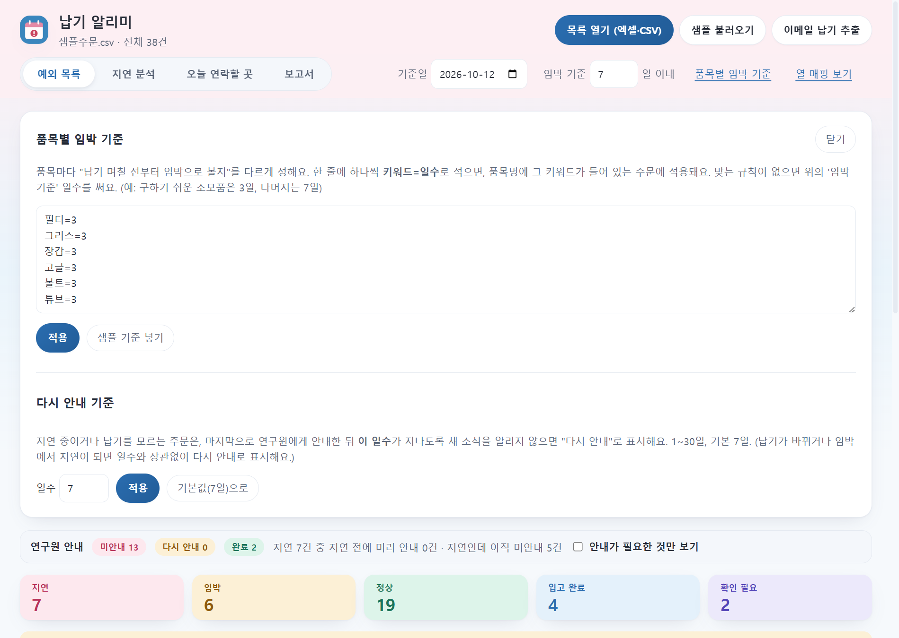 |
| **키보드·좁은 창·대비**: 마우스 없이 표(화살표·Enter·Space)에서 안내 기록까지 가능, 모든 조작 요소에 이름, 좁은 창(900x600)에서 주문을 누르면 상세로 내려가고 "↑ 목록으로"로 복귀, 라이트·다크 글자 대비 4.5 이상. 용어는 `src/labels.js` 사전으로 고정 | |
| **화면 순서와 기록 접근성**: 안내 현황 막대를 요약 카드 위로, 주문 상세는 안내 기록 → 안내문 → 빠른 메모 → 파일 원래 값 → 지연 원인 순으로 바꿔 스크롤 없이 "안내함으로 기록"에 닿게 함(1280x820 측정 1,374px → 0px). 안내문을 복사하면 기록 버튼이 강조됨. **다시 안내 기준**은 품목별 임박 기준 패널에서 1~30일로 설정(기본 7일) | |
| **정렬·검색**: 표 머리글을 눌러 정렬(오름차순 → 내림차순 → 원래 순서), 주문번호·품목·공급사·요청자 검색. 납기일은 표기가 제각각이어도 날짜로 바꿔 비교 | 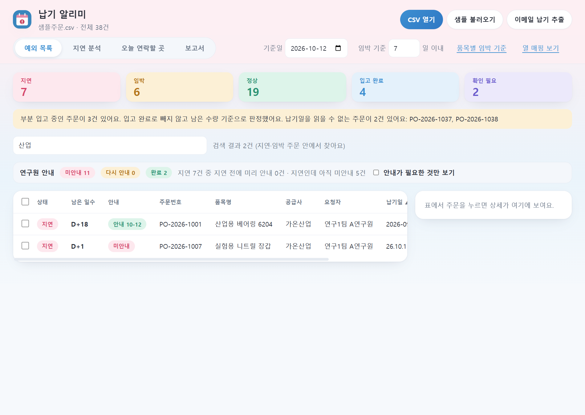 |
| **여러 건 한꺼번에 처리**: 목록에서 체크박스로 고른 주문에 대해 공급사 연락함 기록(오늘 이미 기록한 업체는 건너뜀)·사유 일괄 입력·선택분 CSV 저장 | 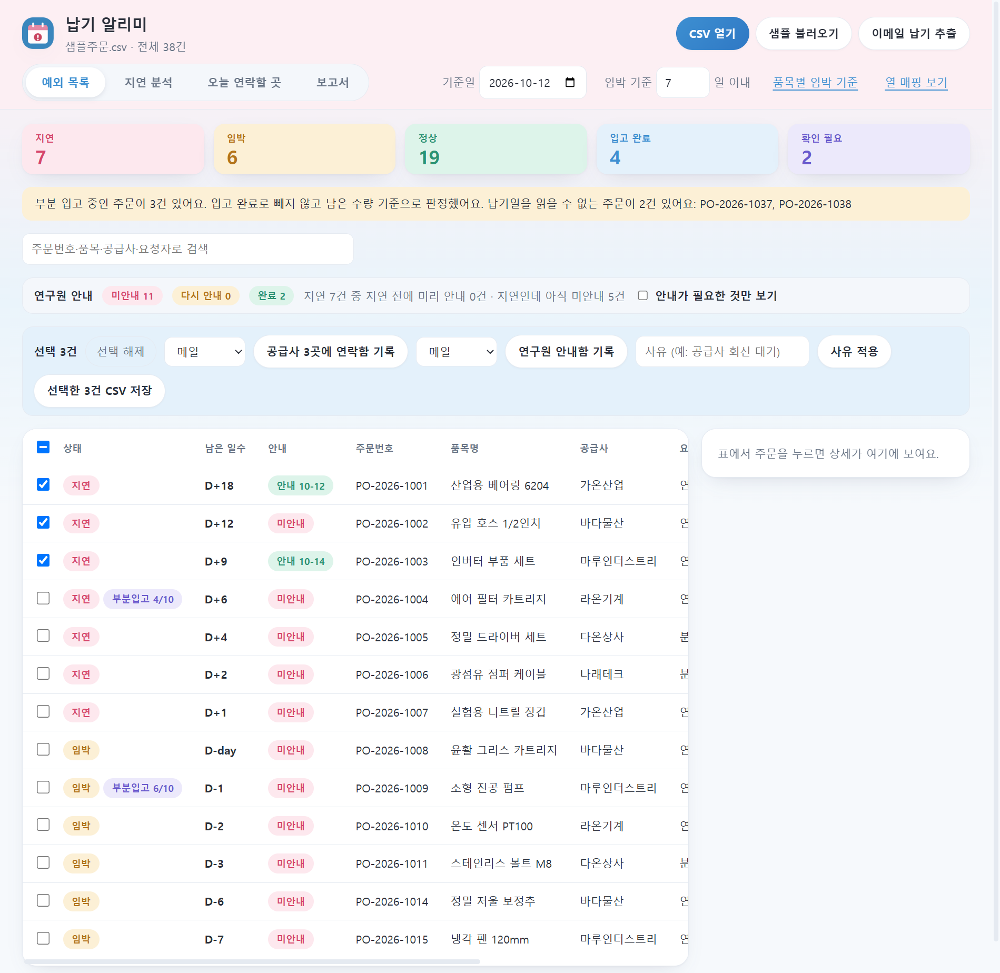 |
| **임박 주문 사전 안내문**: 아직 늦지 않은 주문에는 사과형 대신 "납기 N일 전, 일정 확인 중" 안내를 기본으로 보여 줌(새 납기·입고 시점은 지어내지 않음) | 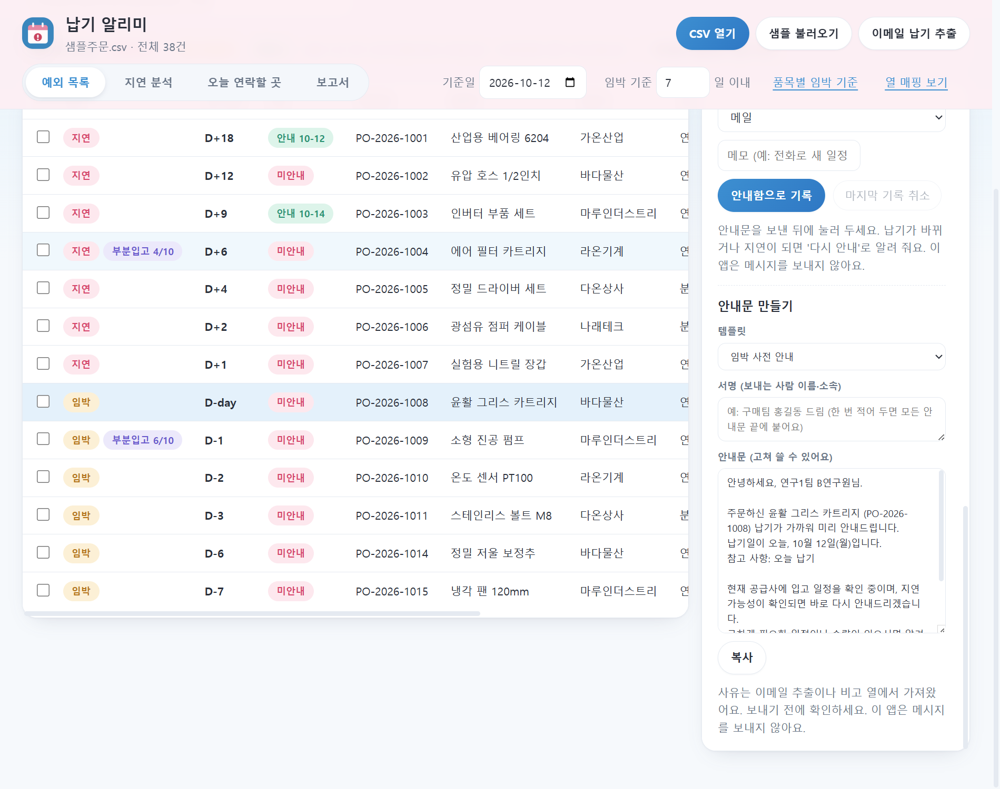 |
| **품목별 임박 기준**: 품목명 키워드로 "며칠 전부터 임박"을 다르게 지정(예: 소모품 3일, 나머지 7일). 샘플은 필터·그리스·장갑·고글·볼트·튜브를 3일로 둠(가정) | 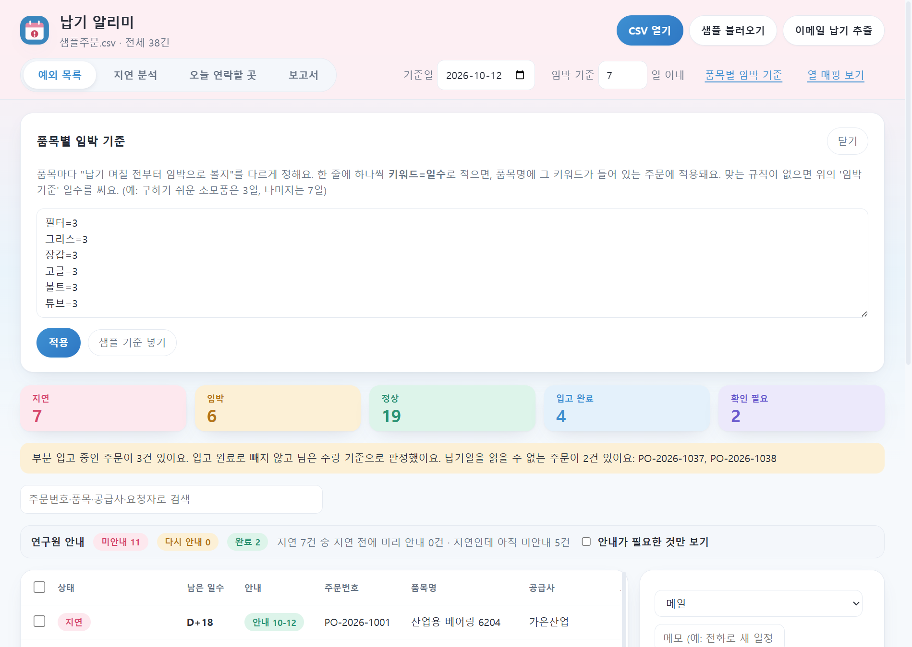 |
| **부분 납품·분납·대체품 확인**: 주문수량과 입고수량을 비교해 **남은 수량만** 지연·임박으로 판정, 공급사가 알려 준 분납 일정을 수량별로 기록, 규격·품명이 다르거나 회신에 "동급·대체" 같은 말이 있으면 **대체품 의심**으로 표시하고 항목별 비교와 연구원 승인 요청·공급사 사전 승인 요구·반려 문구 생성 | 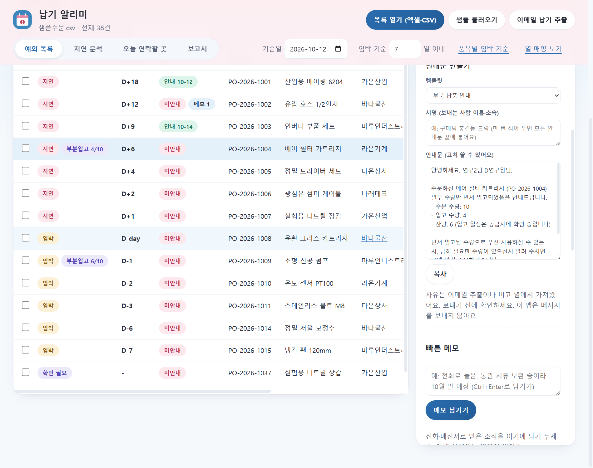 |
| **보고서·내보내기**: 보고 문구 자동 작성, 예외 목록·연락할 곳 CSV 저장 | 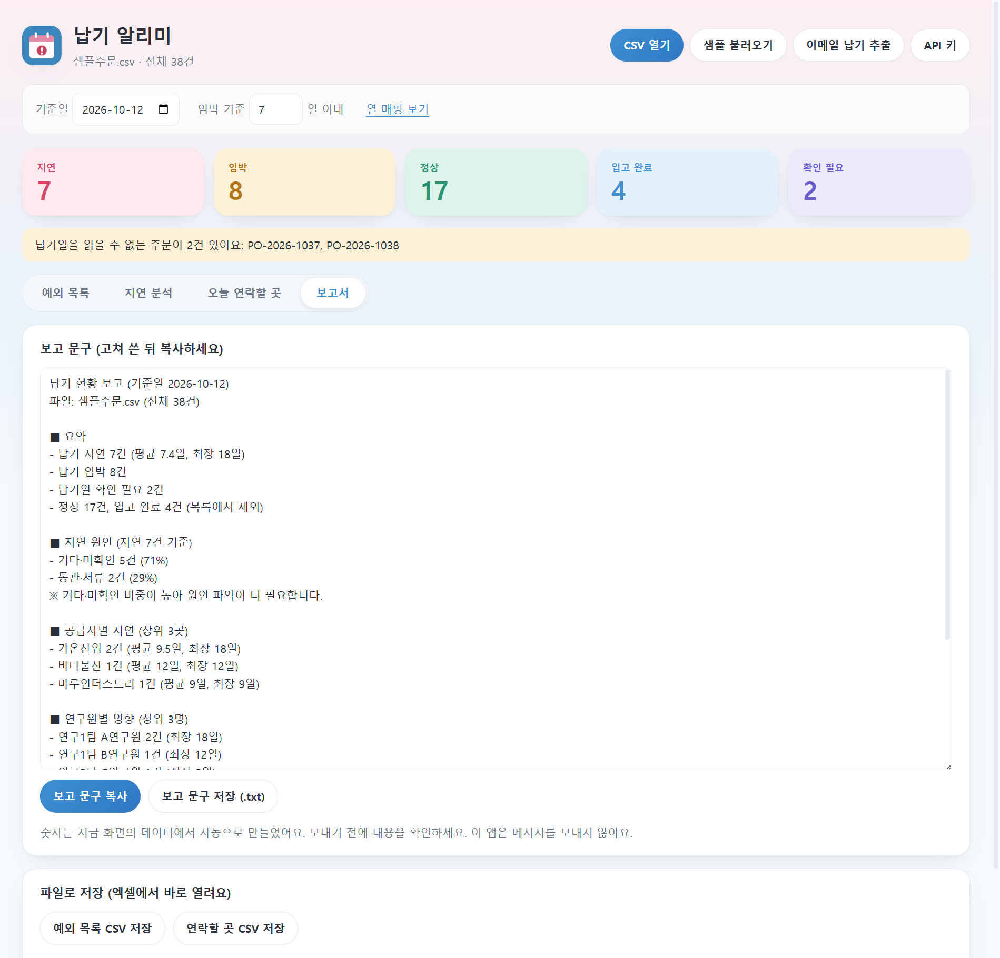 |

라이트·다크 모드 모두 지원합니다. 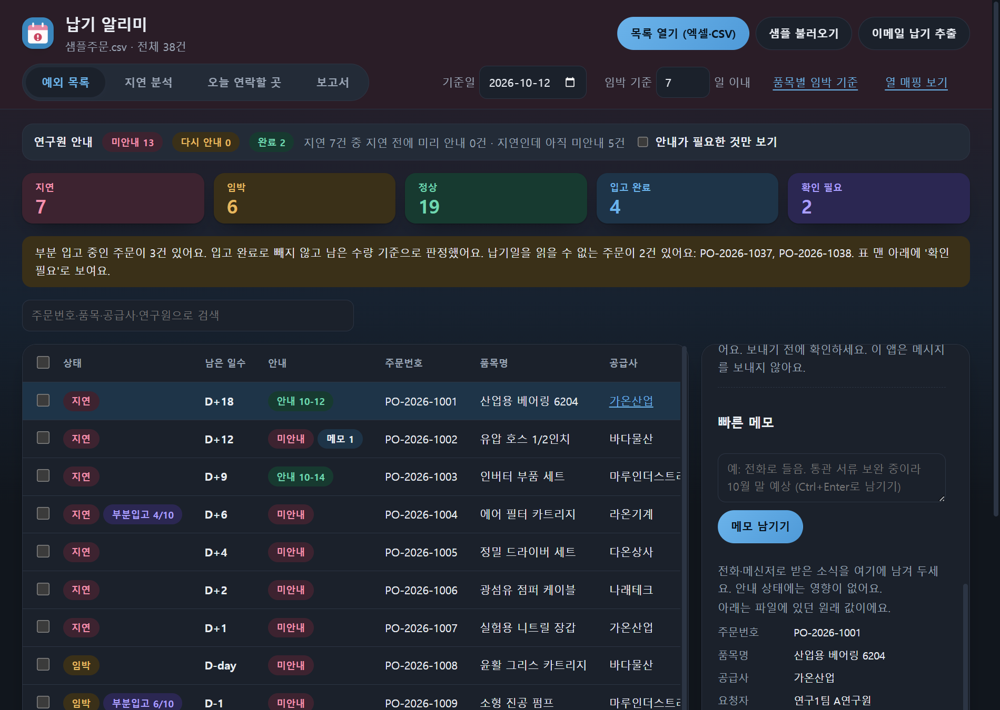

## 어떻게 만들었나

1. **문제 정의**: 문제 발굴소로 원인과 가설을 정리했습니다.
2. **인터뷰 → 기획문서**: 사용자(나 혼자), 데이터 입력, Claude의 역할, 인증 방식, 범위를 질문에 답하며 정했고 모르는 것은 **(가정)**·**(미정)**으로 표시했습니다.
3. **가장 작은 결과물**: 가상 CSV와 판정 규칙(순수 함수)을 먼저 만들고 테스트한 뒤 화면을 얹었습니다.
4. **확장**: Claude 열 매핑 → 이메일 납기 추출 → 지연 분석·안내문 → 저장 → 설치 파일.
5. **현실 반영**: 실제 업무에서는 "공급사가 엑셀을 마음대로 뜯어 보내거나, 아는 것만 채워 보낸다"는 경험을 인터뷰로 풀어 **공급사 엑셀 읽기·미회신 처리·오늘 연락할 곳**을 만들었습니다.
6. **검증**: 기능마다 실제 앱을 띄워 확인하고, 그 과정에서 찾은 버그를 고쳤습니다([포트폴리오 문서](docs/포트폴리오.md)에 사례 정리).

## 설계 결정과 이유

| 결정 | 이유 |
|---|---|
| **API 키 없이도 핵심이 동작**. 규칙이 기본, Claude는 선택 | 비용을 쓰지 않고도 쓸 수 있어야 했고, 메일 내용을 외부로 보내지 않는 모드가 회사에서 더 받아들여지기 쉽다고 봤습니다. |
| **자동으로 바꾸지 않고 확인 후 반영** | 납기 관리에서는 잘못된 날짜를 자신 있게 넣는 것이 더 위험합니다. 변경 전후, 근거 문장, 신뢰도를 보여 주고 사람이 누르게 했습니다. |
| **날짜를 지어내지 않고 "확인 필요"로 남김** | "빠르면 이번 주 중", "11월 초", "다음 주쯤"은 확정하지 않습니다. 근거 문장이 원문에 없으면 반영 버튼을 막습니다. |
| **더 최근 메일이 우선** | 같은 주문이 여러 메일에 나오면 가장 최근 메일 기준으로 보여 주고, 더 최근 메일이 "확인 필요"여도 옛 날짜를 새 정보처럼 보이지 않게 했습니다. 답장에 딸려 온 옛 원문은 잘라 냅니다. |
| **메일 서버 연결 대신 `.eml` 폴더 읽기** | 서버 연결은 회사 IT 승인과 보안 검토가 필요합니다. 승인 없이 지금 만들 수 있는 중간 단계로 했고, 서버 연결은 입사 후 계획으로 남겼습니다. |
| **xlsx·eml을 외부 라이브러리 없이 직접 읽음** | 의존성을 줄이고 설치 파일을 작게 유지하려고 했습니다. 대신 지원 범위가 좁습니다(아래 한계). |
| **보안 처리** | API 키는 메인 프로세스에서만 쓰고 OS 보안 저장소에 암호화 저장, 화면(렌더러)은 키를 읽지 못함. CSV 저장 때 `=`·`+`·`-`·`@`로 시작하는 글은 앞에 `'`를 붙여 엑셀 수식 삽입을 막음. xlsx 압축 폭탄(40MB), 파일 크기·줄 수, 저장 확장자(csv·txt) 제한. |

## 검증

- **자동 테스트 286개**가 모두 통과합니다(`npm test`). 이와 별도로 **실제 앱을 띄워 클릭하는 시험(E2E) 14개 시나리오**(`npm run test:e2e`)가 있고, 설치 파일에 들어가는 패키지된 앱으로도 같은 시험을 통과했습니다(`NABGI_E2E_EXE`). 판정·날짜 경계, 이메일 규칙(가상 표현 23가지), `.eml` 인코딩(UTF-8·EUC-KR·quoted-printable·멀티파트), xlsx 읽기, 공급사 표 비교, 오늘 연락할 곳 정렬, CSV 수식 삽입 방지, 저장 복원 등.
- 기능마다 **실제 앱(Electron)을 띄워** 가상 샘플로 끝까지 눌러 확인했습니다(스크린샷은 그렇게 찍었습니다).
- 가상 샘플은 일부러 지저분하게 만들었습니다: 합친 제목 줄, 열 이름 변경, 두 번째 시트에 표, 같은 주문 두 줄, 합계 줄, 날짜 형식 제각각, EUC-KR 메일, 답장 인용, 주문번호 없는 배송 안내 메일.

## 알려진 한계

솔직하게 적습니다. 이 프로젝트는 **가상 데이터로만** 확인했습니다.

- **실제 이메일·실제 공급사 엑셀로 써 보지 못했습니다.** 규칙은 제가 만든 가상 표현으로 맞춘 것이라 실제 파일에서는 놓치거나 틀릴 수 있습니다(애매하면 "확인 필요"로 남기도록 보수적으로 만들었고, 열·머리글은 확인 화면을 거칩니다).
- **Claude를 실제로 호출해 본 적이 없습니다.** 열 매핑과 이메일 Claude 모드는 예시 응답으로만 동작을 확인했습니다.
- 지연 분석·원인 비중·평균 지연 일수는 가상 데이터라 **숫자에 의미가 없습니다.**
- **지원 형식**: 주문 목록과 공급사 표 모두 `.xlsx`·CSV를 엽니다(`.xls`, PDF·사진 표, 수식 계산 제외). 주문 목록 엑셀은 표 위에 제목 줄이 있어도 머리글을 찾고, 5,000줄·80열을 넘으면 일부만 읽었다고 알립니다, 메일은 `.eml`만(클래식 Outlook `.msg`, 메일 서버 직접 연결 제외).
- **대체품 판정은 규칙(규격·품명 비교, "대체·동급·단종" 같은 말)에 기반한 가정**이며 실제 대체 여부는 사람이 확인합니다. 분납 일정을 반영하면 납기일을 마지막 입고 예정일로 바꾸고, 분납이 지켜졌는지는 추적하지 않습니다. 앱은 메시지를 보내지 않고 문구만 만듭니다.
- 원인 항목·키워드, 안내문 말투, "오늘 연락할 곳" 정렬 점수는 경험과 가정에 기반합니다.
- 저장 기록(`state.json`)은 암호화하지 않았고 주문번호 기준입니다.
- 릴리스 검증 결과(수용 기준 19/19, 조건부 go)는 `docs/RELEASE_CHECK.md`에 있습니다.
- 설치 파일은 만들어서 **안에 든 파일을 점검**하고 **패키지된 앱으로 자동 시험**을 통과했지만, 깨끗한 PC에서 설치·업그레이드·삭제를 직접 해 보지는 못했습니다(절차는 `docs/MANUAL_TESTS.md` M-10). 설치 파일은 서명하지 않았습니다. 아이콘은 직접 그린 임시 그림입니다.

## 키(API 키) 없이도 되나요?

네. 키는 선택입니다.

| 기능 | 키 없이 | 키가 있으면 |
|---|---|---|
| 판정·목록·분석·연락할 곳·안내문·보고서 | 모두 됨 | 같음 |
| 열 매핑 | 이름 기반 추측 + 직접 선택 | Claude가 제안하고 신뢰도·이유 표시 |
| 이메일 납기 추출 | **규칙 모드**(이 컴퓨터 안에서만 처리) | Claude 모드 선택 가능 |

Claude 열 매핑은 열 이름과 앞 3행만, Claude 이메일 추출은 이메일 본문(최대 6,000자)을 보냅니다. 보내는 내용은 화면에서 확인할 수 있습니다. Claude 구독 계정 로그인은 쓰지 않습니다(제3자 앱에서의 사용은 약관상 허용되지 않는 것으로 알고 있습니다).

## 판정 규칙

- 남은 일수 = 납기일 − 기준일. 기준일은 기본이 오늘이고 화면에서 바꿀 수 있습니다(가상 샘플은 2026-10-12 기준).
- **지연**: 납기일이 지났고 입고되지 않음 / **임박**: 기준 일수 이내(기본 7일, 변경 가능) / 입고 완료는 제외.
- 납기일을 읽을 수 없으면 숨기지 않고 **확인 필요**로 따로 보여 줍니다.

## 설치와 실행

- **설치 파일**: `dist/DeliveryWatch-Setup-0.5.0.exe` (약 106MB). 서명하지 않아 Windows SmartScreen이 "알 수 없는 게시자" 경고를 띄울 수 있습니다("추가 정보 → 실행"). 사용자 단위로 설치되고 설치 폴더를 고를 수 있습니다.
- **내 기록이 저장되는 곳**: `%APPDATA%\delivery-watch\state.json` (폴더 이름은 앱 이름이 아니라 패키지 이름). **앱을 삭제해도 이 폴더는 남습니다** (기록을 실수로 잃지 않게 하려는 의도입니다). 0.4.0까지의 기록은 0.5.0 첫 실행 때 새 형식으로 옮겨지고 원본은 `state.v0.bak.json`으로 보관됩니다. 앱은 한 개만 실행됩니다.
- **개발용 실행**: `npm install` 후 `npm start`
- **설치 파일 만들기**: `npm run dist` / **테스트**: `npm test`
- 처음 써 보려면: 「샘플 불러오기」 → 「이메일 납기 추출」 → **공급사 엑셀 읽기**의 샘플 → **오늘 연락할 곳** 탭 순서를 권합니다.

## 폴더 구성

| 경로 | 내용 |
|---|---|
| `기획문서.md` | 기획·설계·변경 기록(v0.4), 가정·미정·한계 |
| `2차-설계.md` | 지연 분석·안내문 설계 근거 |
| `docs/포트폴리오.md` | 면접용 정리(2분 데모, 예상 질문, 찾아 고친 버그 사례) |
| `docs/images/` | 화면 캡처 |
| `main.js`, `preload.js` | 메인 프로세스(파일 열기, 키 저장, Claude 호출, 기록·보고서 저장) |
| `renderer/` | 화면 |
| `src/` | 판정(`judge`), CSV(`csv`), 열 매핑(`mapping`), 이메일(`email`, `emailRules`), 메일 파일(`eml`)·기간 거르기(`mailfilter`), 엑셀 읽기(`xlsx`)·공급사 표 해석(`supplier`)·재문의(`reask`), 원인(`cause`), 집계(`analyze`), 안내문(`notice`), 오늘 연락할 곳(`contact`)·무응답 단계(`escalate`), 보고서·CSV(`report`), 저장(`persist`) |
| `test/` | 단위 테스트 286개 (`emailCases.js`는 가상 이메일 표현 모음, `security.test.js`는 보안 점검) |
| `e2e/`, `tools/` | 실제 앱 자동 시험(14개 시나리오), 성능·접근성·패키지 점검 도구, 캡처 도구 |
| `docs/` | 요구사항 감사, 결정·백로그, 데이터 모델, 성능 기준선(`PERF.md`), 수동 시험 절차 |
| `CHANGELOG.md` | 버전별 변경 내용 |
| `샘플주문.csv`, `샘플메일/`, `샘플공급사/`, `make-sample*.js` | 가상 샘플(주문 38건, 메일 9통, 공급사 엑셀 2개)과 생성기 |
| `build/icon.png` | 앱 아이콘 |
