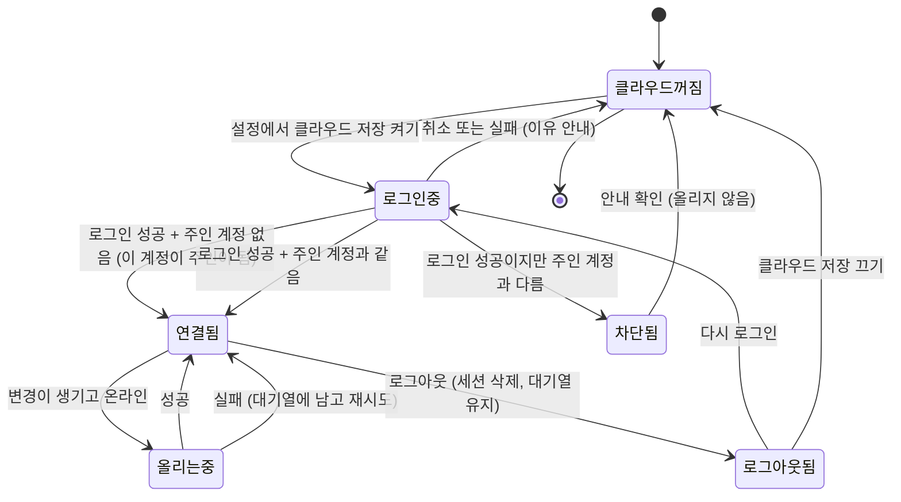

# ERD (Supabase 저장 + 로그인)

갱신: 2026-10-20 · 근거: `docs/DB_PLAN.md`(기획), `docs/adr/0001~0005`, `GLOSSARY.md`, `납기-문제정의/prd_supabase.md` · 상태: **DB는 연습용 Supabase 프로젝트에 구축됨(2026-10-20, `supabase/`). 앱 연결 코드는 아직 없다.** 위 ERD의 `LOCAL_*`은 아직 구현 전

이 문서가 ERD의 **유일한 원본**이다(`DB_PLAN.md`는 이 문서를 가리킨다). 이번에 **로그인**을 넣었다: 계정은 Supabase가 관리하는 `AUTH_USERS`, 이 PC에만 있는 연결 정보(`LOCAL_CLOUD_LINK`)와 세션(`LOCAL_SESSION`)을 점선으로 이었다.

> Supabase의 기능·한도·정책은 확인하지 않았다(착수 때 공식 문서로 확인).

## 1. ERD

- 실선은 데이터베이스 안의 연결(외래키)이다. 점선은 "글자나 값으로 가리킨다"는 뜻이고 외래키가 아니다.
- `ORDER_FILE_ROW`(주문)와 `SUPPLIER_NAME`(공급사)은 표가 아니라 외부 개념이다(ADR-0004).
- `LOCAL_*`은 **데이터베이스가 아니라 이 PC에만 있는 것**이다.

```mermaid
erDiagram
    AUTH_USERS ||--o{ INFORM_LOGS : user_id
    AUTH_USERS ||--o{ QUICK_NOTES : user_id
    AUTH_USERS ||--o{ ORDER_META : user_id
    AUTH_USERS ||--o{ SUBSTITUTE_CHECKS : user_id
    AUTH_USERS ||--o{ SCHEDULE_ENTRIES : user_id
    AUTH_USERS ||--o{ SUPPLIER_CONTACT_LOGS : user_id
    AUTH_USERS ||--o{ SUPPLIER_CONTACT_MARKS : user_id
    AUTH_USERS ||--|| USER_SETTINGS : user_id

    LOCAL_CLOUD_LINK }o..|| AUTH_USERS : "owner_user_id (주인 계정)"
    LOCAL_SESSION }o..|| AUTH_USERS : "로그인한 계정"

    ORDER_FILE_ROW }o..o{ INFORM_LOGS : order_no
    ORDER_FILE_ROW }o..o{ QUICK_NOTES : order_no
    ORDER_FILE_ROW }o..o| ORDER_META : order_no
    ORDER_FILE_ROW }o..o{ SUBSTITUTE_CHECKS : order_no
    ORDER_FILE_ROW }o..o{ SCHEDULE_ENTRIES : order_no
    SUPPLIER_NAME }o..o{ SUPPLIER_CONTACT_LOGS : supplier_name
    SUPPLIER_NAME }o..o| SUPPLIER_CONTACT_MARKS : supplier_name

    AUTH_USERS {
        uuid id PK "Supabase가 관리"
        text email "로그인 아이디"
        text password "Supabase가 해시로 보관 (앱은 모름)"
        timestamptz created_at "본인이 Supabase 화면에서 1개 생성"
    }
    LOCAL_CLOUD_LINK {
        boolean enabled "클라우드 저장 켬"
        text project "practice 또는 work"
        uuid owner_user_id "첫 로그인 계정. 다른 계정은 막음"
        timestamptz linked_at
        timestamptz last_synced_at
    }
    LOCAL_SESSION {
        blob encrypted_token "OS 보안 저장소로 암호화"
        timestamptz saved_at
    }
    ORDER_FILE_ROW {
        text order_no "DB에 없음 (파일에서 읽음)"
    }
    SUPPLIER_NAME {
        text supplier_name "DB에 없음 (이름 글자)"
    }
    INFORM_LOGS {
        uuid id PK
        uuid user_id FK "default auth.uid()"
        text order_no
        date logged_on
        text channel "메일 카톡·문자 전화 구두 기타"
        text status "지연 임박 확인필요"
        text due "납기일 칸 글자 40자"
        text note "200자"
        timestamptz created_at
        timestamptz deleted_at
        text deleted_reason "user cap"
    }
    QUICK_NOTES {
        uuid id PK
        uuid user_id FK
        text order_no
        text body "300자"
        timestamptz created_at
        timestamptz deleted_at
        text deleted_reason
    }
    ORDER_META {
        uuid user_id PK
        text order_no PK
        text reason
        text cause_override
        text edited_from
        text edited_to
        timestamptz updated_at
    }
    SUBSTITUTE_CHECKS {
        uuid id PK
        uuid user_id FK
        text order_no
        text state "의심 확인요청중 승인 거절"
        text note
        text sup_item
        text sup_spec
        text sup_qty
        text source
        date checked_on
        timestamptz created_at
        timestamptz deleted_at
        text deleted_reason
    }
    SCHEDULE_ENTRIES {
        uuid id PK
        uuid user_id FK
        text order_no
        date arrives_on
        text qty "20자"
        timestamptz created_at
        timestamptz deleted_at
        text deleted_reason
    }
    SUPPLIER_CONTACT_LOGS {
        uuid id PK
        uuid user_id FK
        text supplier_name
        date logged_on
        text kind "attempt reply"
        text channel "10자"
        date promised_on
        text note "200자"
        timestamptz created_at
        timestamptz deleted_at
        text deleted_reason
    }
    SUPPLIER_CONTACT_MARKS {
        uuid user_id PK
        text supplier_name PK
        date last_contacted_on
        timestamptz updated_at
    }
    USER_SETTINGS {
        uuid user_id PK
        jsonb data "안내문 템플릿·서명, 품목별 임박 기준, 다시 안내 일수"
        timestamptz updated_at
    }
```

### 표 읽는 법

| 종류 | 표 | 규칙 |
|---|---|---|
| **계정** (Supabase가 관리) | `AUTH_USERS` | 앱이 만들거나 고치지 않는다. 사용자가 Supabase 화면에서 하나 만든다. 공개 가입은 닫는다 |
| **쌓는 기록** (append-only) | `INFORM_LOGS`, `QUICK_NOTES`, `SUPPLIER_CONTACT_LOGS`, `SUBSTITUTE_CHECKS`, `SCHEDULE_ENTRIES` | 행은 고치지 않는다. 지울 때는 `deleted_at`·`deleted_reason`만 채운다. `id`는 앱이 만든 UUID라 올리기가 멱등이다 |
| **현재 값** (last-write-wins) | `ORDER_META`, `SUPPLIER_CONTACT_MARKS`, `USER_SETTINGS` | 키 하나에 행 하나. `updated_at`이 최신인 쪽이 이긴다 |
| **이 PC에만** (DB 아님) | `LOCAL_CLOUD_LINK`, `LOCAL_SESSION` | 아래 3절 |
| **외부 개념** (표 없음) | 주문, 공급사 | 주문번호·공급사 이름 글자로 가리킨다 |

`user_id`는 앱이 보내지 않는다. 모든 표의 `user_id`는 `default auth.uid()`로 DB가 로그인한 사용자로 채우고, RLS 정책(`user_id = auth.uid()`)이 본인 행만 읽고 쓰게 한다. 열 제약과 인덱스는 `DB_PLAN.md` 3절.

## 2. 로그인 설계 (간단)

`grill-with-docs` 인터뷰(2026-10-20, 2라운드)로 정했다. 되돌리기 어려운 이유와 대안은 `docs/adr/0005`.

| 질문 | 결정 |
|---|---|
| 방식 | 이메일 + 비밀번호 |
| 가입 | **공개 가입을 닫는다.** 계정은 Supabase 화면에서 본인이 하나 만든다. 앱에 가입 화면 없음 |
| 로그인 없이 사용 | 모든 기능 사용 가능. 로그인은 **클라우드 저장을 켤 때만** |
| 다른 계정 | 첫 로그인 계정이 이 PC 로컬 기록의 **주인 계정**이 되고, 다른 계정은 **막는다** |
| 세션 유지 | 자동 유지(OS 보안 저장소로 암호화), 로그아웃할 때까지. 보안 저장소를 못 쓰면 앱을 켠 동안만 |
| 비밀번호 분실 | 앱에 기능 없음. Supabase 화면에서 본인이 바꾼다 |
| 로그아웃 | 세션만 지운다. 로컬 기록과 못 올린 대기열은 그대로 두고 올리기만 멈춘다 |
| DB의 로그인 관련 표 | 없음(`auth.users`만). 연결 정보는 로컬 파일에 |

### 상태 흐름

"클라우드꺼짐"이 처음 상태이자 기본 상태이고, 이 상태에서는 지금 앱과 100% 같다.

### 화면 (IA에 추가할 ID, `prd_supabase.md`와 같음)

| ID | 화면 | 로그인 관련 내용 |
|---|---|---|
| SY-11-M | 클라우드 저장 설정 | 켜기/끄기, 로그아웃 단추, 연결된 프로젝트·주인 계정 표시 |
| AU-11-M | 로그인 | 이메일·비밀번호 입력. 실패하면 이유 안내. 가입·비밀번호 재설정 링크 없음 |
| SY-21-A | 동기화 상태 | 로그인 상태, 마지막 올린 시각, 대기 건수, 오류 |

## 3. 이 PC에만 있는 것 (데이터베이스 아님)

| 이름 | 어디에 | 담는 것 |
|---|---|---|
| `LOCAL_CLOUD_LINK` (`cloudLink`) | 로컬 `state.json`의 한 영역(저장 형식 v2에 추가) | 클라우드 저장 켬 여부, 연결한 프로젝트(`practice`/`work`), **주인 계정 id**, 연결한 시각, 마지막으로 올린 시각 |
| `LOCAL_SESSION` | OS 보안 저장소로 암호화한 별도 파일(API 키 파일과 같은 방식) | 로그인 세션. 화면 코드는 읽지 못한다(메인 프로세스만) |
| 대기열(outbox) | 로컬 파일 | 못 올린 변경. 올릴 때 로그인한 계정이 **주인 계정과 같은지** 먼저 확인한다 |

대기열과 로컬 기록의 행에는 `user_id`가 없다. 올릴 때 DB가 채운다.

## 4. 가정·열린 질문 (로그인 관련)

| 구분 | 내용 |
|---|---|
| 한계 | 주인 계정을 바꾸는 **정식 방법이 아직 없다.** 계정을 새로 만들면 이 PC에서 로그인이 막힌다. 연결 정보를 지우는 방법(연결 해제)은 착수 때 정한다 |
| 한계 | 비밀번호 재설정·가입이 앱에 없으므로 사용자를 늘리려면(팀 사용) 로그인 설계를 다시 연다 |
| 확인하지 않음 | Supabase의 공개 가입 끄기 방법, 로그인 시도 제한, 세션 수명, 비밀번호 정책, Electron 메인 프로세스에서의 클라이언트 사용법 |
| 위험 | 세션을 OS 보안 저장소에 두는 것은 그 PC·그 Windows 계정에 로그인한 사람이면 앱을 열 수 있다는 뜻이다(로컬 `state.json`이 평문인 것과 같은 수준의 한계) |
| 위험 | 업무용 프로젝트에서는 로그인 보안(비밀번호 정책, 추가 인증)을 보안 승인 때 다시 정한다(ADR-0003) |
| 열린 질문 | 연결 해제, 주인 계정 확인 시 실패 문구, 로그인 화면의 위치(설정 안인지 첫 화면인지), 보안 저장소를 못 쓰는 PC의 안내 |
